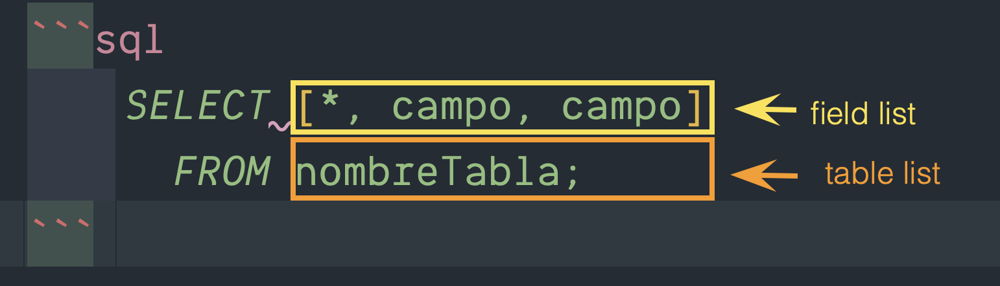

# Consultas en SQL
Podemos realizar consultas a:

1. Servidor
2. Base de datos
3. Tablas
4. Vistas

# 1. Consultas a Servidor
```sql
-- listar todas las bases de datos de un server
SHOW DATABASES;

-- ver la base de datos activa
SELECT DATABASE();

-- listar usuarios conectados
SELECT USER();

-- ver fecha actual
SELECT current_date();
```

## 2. Consultas a Base de datos
```sql
-- listar todas las tablas dentro de una base de datos
SHOW TABLES;

-- sintaxis alternativa
SELECT TABLE_NAME FROM
    information_schema.tables
WHERE table_schema = DATABASE();  
```

## 3. Consultas a tablas
```sql
-- ver la estructura de una tabla
DESCRIBE nombreTabla;

-- obtener grilla de resultados (todos los registros dentro de una tabla)
SELECT * FROM nombreTabla;
SELECT * FROM clientes;
SELECT * FROM proveedores;
```
Cuándo nuestra consulta dice *SELECT \* FROM nombreTabla;*
Vamos a obtener un listado con la totalidad de registros y todas las columnas de una tabla.
Si lo que queremos es ver solamente los datos de algunas columnas, debemos reemplazar el símbolo de \* por un listado de las columnas.

```sql
-- ver las columnas apellido, nombre y teléfono
SELECT apellido, nombre, telefono 
  FROM clientes;
```

Hasta ahora nuestra sintaxis es la siguiente:

```sql
    SELECT [*, campo, campo]
      FROM nombreTabla;
```

